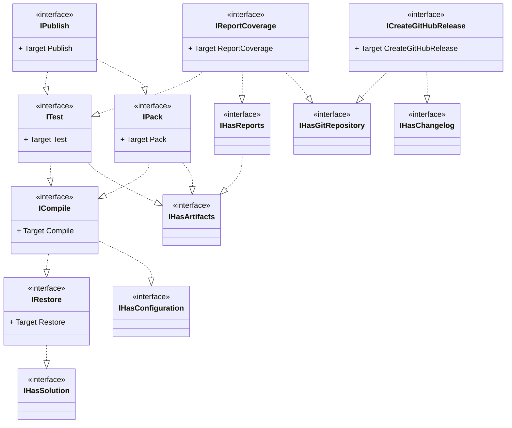

Fallout ships a set of ready-made [build components](02-build-components.md) for the usual .NET pipeline: restore, compile, test, pack, publish, and a few extras. They live in the `Fallout.Components` package and namespace. To use one, add the package to your build project and inherit the interface in your `Build` class:

```xml title="_build.csproj"
<PackageReference Include="Fallout.Components" />
```

```csharp title="Build.cs"
using Fallout.Components;

class Build : FalloutBuild, ITest, IPack
{
    public static int Main() => Execute<Build>(x => ((IPack)x).Pack);

    // The only member ITest requires you to implement
    IEnumerable<Project> ITest.TestProjects => From<IHasSolution>().Solution.GetAllProjects("*.Tests");
}
```

With these few lines you get the `Restore`, `Compile`, `Test` and `Pack` targets. They use the solution next to your build (through [`[Solution]`](../03-common/07-solution-project-model.md)), the `Debug` configuration locally and `Release` on a build server, and they write all output to the `artifacts` directory.

## Overview

The components build on each other. Inheriting a component also gives you everything it inherits:



There are two kinds of components:

- **Target components** such as `ICompile` and `ITest` define one or more targets.
- **State components** such as `IHasSolution` and `IHasArtifacts` only provide values (a solution, a directory, a version) that other components use. Their names start with `IHas`.

## Customizing a component

All target components follow the same pattern, so you only have to learn it once.

### Settings

Each target calls a tool task (for example `DotNetTest`) and applies two sets of settings, in this order:

1. `…SettingsBase` (for example `TestSettingsBase`): the defaults of the component. These members are `sealed`, so you can't replace them.
2. `…Settings` (for example `TestSettings`): empty by default. Implement it to add or change settings. Because it runs after the base settings, it wins.

Implement the member as an [explicit interface implementation](https://docs.microsoft.com/en-us/dotnet/csharp/programming-guide/interfaces/explicit-interface-implementation):

```csharp
class Build : FalloutBuild, ITest
{
    Configure<DotNetTestSettings> ITest.TestSettings => _ => _
        .SetProcessEnvironmentVariable("MY_TELEMETRY_OPTOUT", "true");
}
```

Other simple members, such as directories and degrees of parallelism, can be changed the same way:

```csharp
AbsolutePath IHasArtifacts.ArtifactsDirectory => RootDirectory / "output";
```

### Targets

To add behavior to a target, or to replace it completely, use the techniques from [Extensions and Overrides](02-build-components.md#extensions-and-overrides):

```csharp
class Build : FalloutBuild, ITest
{
    Target ITest.Test => _ => _
        .Inherit<ITest>()
        .Partition(2);
}
```

### Optional integrations

Some components check whether your build *also* inherits one of these state components, and use it when it does:

| When you also inherit | The components then |
|-----------------------|---------------------|
| `IHasGitVersion` | Set the assembly, file and informational version (`ICompile`), the package version (`IPack`), and show the version in the build summary. |
| `IHasNerdbankGitVersioning` | Same as `IHasGitVersion`, but with the values from Nerdbank.GitVersioning. |
| `IHasGitRepository` | Set the repository URL on build, publish and pack. |
| `IHasChangelog` | Set the package release notes from your changelog (`IPack`). |

So you don't configure versioning in each target. You inherit the versioning component once:

```csharp
class Build : FalloutBuild, IPack, IHasGitRepository, IHasNerdbankGitVersioning
{
}
```

## Target components

### `IRestore`

Restores the NuGet packages of the solution with `dotnet restore`.

| | |
|---|---|
| Target | `Restore` |
| Inherits | `IHasSolution` |
| Customize | `RestoreSettings` |
| Parameters | `IgnoreFailedSources` (default `false`): ignore NuGet sources that can't be reached |

### `ICompile`

Builds the solution with `dotnet build`. After that, it runs `dotnet publish` for each project and framework in `PublishConfigurations`. By default that list is empty, so nothing is published.

| | |
|---|---|
| Target | `Compile`, depends on `Restore` |
| Inherits | `IRestore`, `IHasConfiguration` |
| Customize | `CompileSettings`, `PublishSettings`, `PublishConfigurations`, `PublishDegreeOfParallelism` (default `10`) |

Notes:

- When `Restore` ran successfully in the same build, `Compile` passes `--no-restore`.
- On a build server, it enables `ContinuousIntegrationBuild`.

To publish an app for every framework it targets:

```csharp
IEnumerable<(Project Project, string Framework)> ICompile.PublishConfigurations =>
    from project in new[] { Solution.MyApp }
    from framework in project.GetTargetFrameworks()
    select (project, framework);
```

### `ITest`

Runs `dotnet test` for each project in `TestProjects`.

| | |
|---|---|
| Target | `Test`, depends on `Compile` |
| Inherits | `ICompile`, `IHasArtifacts` |
| You must implement | `TestProjects` |
| Customize | `TestSettings` (all projects), `TestProjectSettings` (per project), `TestResultDirectory` (default `artifacts/test-results`), `TestDegreeOfParallelism` (default `1`), `UseTestingPlatform` (default `false`) |
| Produces | `*.trx` and `*.xml` files in `TestResultDirectory` |

`TestProjects` decides which projects are tests. A common choice is a naming convention:

```csharp
IEnumerable<Project> ITest.TestProjects => Solution.GetAllProjects("*.Tests");
```

What the `Test` target does for you:

- **Runs all projects, even when one fails.** It reports the failure after all projects ran. Set `TestDegreeOfParallelism` to run more than one project at the same time.
- **Skips the build** (`--no-build`) when `Compile` ran successfully in the same build.
- **Writes a TRX file per project** named `<Project>.trx`.
- **Collects code coverage** with Coverlet in Cobertura format (`<Project>.xml`) when it runs on a build server, or when you also invoke `ReportCoverage`. Files that end in `.Generated.cs` are excluded. On TeamCity, it also writes the TeamCity format. On a build server it enables Source Link.
- **Adds CI loggers** when a test project references them: the `GitHubActions` logger for [GitHubActionsTestLogger](https://github.com/Tyrrrz/GitHubActionsTestLogger) on GitHub Actions, and the `TeamCity` logger for [TeamCity.VSTest.TestAdapter](https://github.com/JetBrains/TeamCity.VSTest.TestAdapter) on TeamCity.
- **Publishes test results** to Azure Pipelines when it runs there.
- **Adds the passed, failed and skipped counts** to the build summary.

Use `TestProjectSettings` for settings that depend on the project. The second parameter is the project:

```csharp
Configure<DotNetTestSettings, Project> ITest.TestProjectSettings => (_, project) => _
    .When(project.Name.EndsWith("IntegrationTests"), _ => _
        .SetFilter("Category!=Slow"));
```

To read `TestDegreeOfParallelism` from the command line, implement it as a [parameter](../02-fundamentals/06-parameters.md):

```csharp
[Parameter]
public int TestDegreeOfParallelism { get; } = 1;
```

#### Microsoft.Testing.Platform

By default, `Test` runs the tests with VSTest. Some test frameworks, such as xunit v3, no longer support VSTest with the .NET 10 SDK. For those, set `UseTestingPlatform` to `true`. The target then runs `dotnet test --project` on [Microsoft.Testing.Platform](https://learn.microsoft.com/dotnet/core/testing/microsoft-testing-platform-intro):

```csharp
bool ITest.UseTestingPlatform => true;
```

This needs some setup:

- Opt in to the platform in the `global.json` of your repository:

  ```json title="global.json"
  {
    "test": { "runner": "Microsoft.Testing.Platform" }
  }
  ```

- Add the `Microsoft.Testing.Extensions.TrxReport` package to each test project, so it can write TRX files.
- For code coverage, add the `coverlet.MTP` package to each test project.

In this mode, the target works differently:

- It runs the projects one by one. `TestDegreeOfParallelism`, `TestSettings` and `TestProjectSettings` are not used.
- It doesn't add the GitHub Actions or TeamCity loggers.
- Coverage files are named `coverage.cobertura.*.xml`. The target deletes the ones from earlier runs before it starts.

It still writes `<Project>.trx`, runs all projects even when one fails, skips the build when `Compile` ran, publishes the results to Azure Pipelines, and adds the counts to the build summary.

### `IPack`

Creates NuGet packages for the solution with `dotnet pack`.

| | |
|---|---|
| Target | `Pack`, depends on `Compile` |
| Inherits | `ICompile`, `IHasArtifacts` |
| Customize | `PackSettings`, `PackagesDirectory` (default `artifacts/packages`) |
| Produces | `*.nupkg` files in `PackagesDirectory` |

It skips the build (`--no-build`) when `Compile` ran successfully, and adds the number of packages to the build summary. See [Optional integrations](#optional-integrations) for the package version and release notes.

### `IPublish`

Pushes the packages to one or more NuGet feeds with `dotnet nuget push`.

| | |
|---|---|
| Target | `Publish`, depends on `Test` and `Pack` |
| Inherits | `IPack`, `ITest` |
| Parameters | `NuGetSource` (default `https://api.nuget.org/v3/index.json`), `NuGetApiKey` (secret), `PublishTo` (experimental, see below) |
| Customize | `PushSettings`, `PackagePushSettings`, `PushPackageFiles` (default: all `*.nupkg` in `PackagesDirectory`), `PushDegreeOfParallelism` (default `5`), `PushCompleteOnFailure` (default `true`), `PublishTargets` (experimental, see below) |

By default, `Publish` pushes all packages to `NuGetSource` with `NuGetApiKey`. It passes `--skip-duplicate`, so you can run it again when a version is already on the feed. The target fails before it pushes anything when the API key is missing or when there are no packages.

To leave out some packages:

```csharp
IEnumerable<AbsolutePath> IPublish.PushPackageFiles =>
    From<IPack>().PackagesDirectory.GlobFiles("*.nupkg")
        .Where(x => !x.NameWithoutExtension.EndsWith(".Internal"));
```

#### Publishing to more than one feed

:::caution
`PublishTargets` and `PublishTo` are [experimental](https://github.com/Fallout-build/Fallout/blob/main/docs/experimental-apis.md) (`FALLOUT001`). They can change in a later version. To use them, suppress the `FALLOUT001` warning.
:::

Implement `PublishTargets` to push the same packages to several feeds. Each `PublishTarget` has a name, a feed URL and an API key. `IncludePackages` and `ExcludePackages` decide which packages go to that feed. They accept `*` and `?` wildcards, are matched against the file name without `.nupkg`, and are not case-sensitive. When a package matches both, it is excluded. `SkipDuplicate` is `true` by default.

```csharp
#pragma warning disable FALLOUT001
IEnumerable<PublishTarget> IPublish.PublishTargets => new[]
{
    new PublishTarget
    {
        Name = "github-packages",
        Source = "https://nuget.pkg.github.com/my-org/index.json",
        ApiKey = GitHubToken,
    },
    new PublishTarget
    {
        Name = "nuget.org",
        Source = "https://api.nuget.org/v3/index.json",
        ApiKey = NuGetApiKey,
        IncludePackages = new[] { "MyCompany.*" },
        ExcludePackages = new[] { "*.Internal.*" },
    },
};
#pragma warning restore FALLOUT001
```

By default, `Publish` pushes to all targets. Use the `PublishTo` parameter to choose some of them:

```bash
dotnet fallout Publish --publish-to nuget.org
```

When you implement `PublishTargets`, `NuGetSource` and `NuGetApiKey` are not used, unless you use them in your own targets.

### `IReportCoverage`

Turns the coverage files from `ITest` into reports.

| | |
|---|---|
| Target | `ReportCoverage`, depends on `Test` |
| Inherits | `ITest`, `IHasReports`, `IHasGitRepository` |
| You must implement | `CreateCoverageHtmlReport`, `ReportToCodecov` |
| Parameters | `CodecovToken` (secret, required when `ReportToCodecov` is `true`) |
| Customize | `ReportGeneratorSettings`, `CodecovSettings`, `CoverageReportDirectory` (default `artifacts/reports/coverage-report`) |
| Produces | `CoverageReportArchive` (default `artifacts/reports/coverage-report.zip`) |

- When `CreateCoverageHtmlReport` is `true`, it creates an HTML report with [ReportGenerator](https://github.com/danielpalme/ReportGenerator) and zips it.
- When `ReportToCodecov` is `true`, it uploads the coverage to [Codecov](https://codecov.io).
- On Azure Pipelines, it always publishes the coverage to the pipeline.

```csharp
bool IReportCoverage.CreateCoverageHtmlReport => true;
bool IReportCoverage.ReportToCodecov => false;
```

### `ICreateGitHubRelease`

Creates a GitHub release and uploads files to it. If a release with the same name already exists, it uploads the files to that release.

| | |
|---|---|
| Target | `CreateGitHubRelease` |
| Inherits | `IHasGitRepository`, `IHasChangelog` |
| You must implement | `Name` (also used as the tag), `AssetFiles` |
| Parameters | `GitHubReleaseGitHubToken` (secret, required; defaults to the token of the GitHub Actions run) |
| Customize | `Prerelease` (default `false`), `Draft` (default `false`) |

The release text is the latest section of your changelog. The parameter has the `GitHubRelease` [prefix](02-build-components.md#parameter-prefixes).

### `ISignPackages`

Signs packages with [SignPath](https://signpath.io). This only works on [AppVeyor](https://www.appveyor.com/); on other hosts the target is skipped.

| | |
|---|---|
| Target | `SignPackages`. When you also inherit `IPack` and `IPublish`, it depends on `Pack`, and `Publish` depends on it. |
| You must implement | `SignPathPackages` |
| Parameters | `SignPathSettings` (organization ID, project slug, policy slug; required), `SignPathApiToken` (secret, required) |
| Customize | `SignPathReplacePackages` (default `true`: replace the unsigned packages with the signed ones) |

The target uploads the packages to AppVeyor as a signing request, waits for SignPath to sign them, and downloads the result. The link to approve or deny the request appears in the build summary. The XML documentation of `ISignPackages` lists the setup steps for SignPath and AppVeyor.

### `IGlobalTool`

Installs your build project as a [.NET global tool](https://docs.microsoft.com/en-us/dotnet/core/tools/global-tools) on your machine. This is useful for [global builds](01-global-builds.md).

| | |
|---|---|
| Targets | `PackGlobalTool`, `InstallGlobalTool` (uninstalls and packs first), `UninstallGlobalTool`. All are hidden from the target list. |
| Customize | `GlobalToolPackageName` (default: the name of the build project), `GlobalToolVersion` (default `1.0.0`) |

## State components

| Component | Provides | Default |
|-----------|----------|---------|
| `IHasSolution` | `Solution` | The solution found by [`[Solution]`](../03-common/07-solution-project-model.md). Required. |
| `IHasConfiguration` | `Configuration` parameter | `Debug` locally, `Release` on a build server. The `Configuration` class has `Debug` and `Release` and converts to `string`. |
| `IHasArtifacts` | `ArtifactsDirectory` | `<root>/artifacts` |
| `IHasReports` | `ReportDirectory` | `<ArtifactsDirectory>/reports` |
| `IHasGitRepository` | `GitRepository` | The repository found by [`[GitRepository]`](../03-common/05-repository.md). Required. |
| `IHasGitVersion` | `Versioning` | Result of [GitVersion](../03-common/06-versioning.md). Required. |
| `IHasNerdbankGitVersioning` | `Versioning` | Result of [Nerdbank.GitVersioning](../03-common/06-versioning.md). Required. |
| `IHasChangelog` | `ChangelogFile`, `NuGetReleaseNotes` | `<root>/CHANGELOG.md` |
| `IHasTwitterCredentials` | `TwitterConsumerKey`, `TwitterConsumerSecret`, `TwitterAccessToken`, `TwitterAccessTokenSecret` parameters | None. All secret. |

"Required" means the build fails when the value can't be resolved.

To use your own `[Solution]` field instead of the one from `IHasSolution`, implement the member and return your field:

```csharp
[Solution(GenerateProjects = true)] readonly Solution Solution;
Solution IHasSolution.Solution => Solution;
```

## Full example

The Fallout repository builds itself with these components. Here is a shortened version of its [`Build.cs`](https://github.com/Fallout-build/Fallout/blob/main/build/Build.cs):

```csharp title="Build.cs"
class Build : FalloutBuild,
    IHasGitRepository, IHasChangelog,
    IRestore, ICompile, ITest, IReportCoverage, IPack, IPublish
{
    public static int Main() => Execute<Build>(x => ((IPack)x).Pack);

    [Solution(GenerateProjects = true)] readonly Solution Solution;
    Solution IHasSolution.Solution => Solution;

    IEnumerable<Project> ITest.TestProjects => Solution.GetAllProjects("*.Tests");

    bool IReportCoverage.CreateCoverageHtmlReport => true;
    bool IReportCoverage.ReportToCodecov => false;

    [Parameter] [Secret] readonly string NuGetApiKey;
    string IPublish.NuGetApiKey => NuGetApiKey;
}
```
